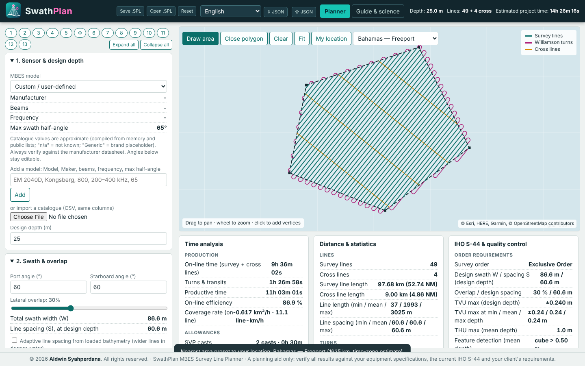

# SwathPlan

**A free multibeam (MBES) survey line planner that runs in your browser.**
Draw the area, set your sonar, get the lines, check them against IHO S-44, and export them for your acquisition software. It is one HTML file with nothing to install and no account to create.

▶ **All tools:** https://syahperdana.github.io/swathplan/  ·  **Survey planner:** https://syahperdana.github.io/swathplan/planner/
🎬 **Demo video (84 s):** [docs/demo.mp4](docs/demo.mp4)

---

## Why I built it

Planning MBES lines usually means a spreadsheet for line spacing, a CAD file for the geometry and a calculator for the time estimate. I wanted to do all of that on one page, quickly, and hand clients a sheet that looks like a proper plan.

SwathPlan is a **planning aid**. It does not replace your acquisition software or your own judgement (see [Disclaimer](#disclaimer)).

## What it does

**Planning**
- Draw the survey area on the map, or import a boundary from a file or pasted coordinates (including plain `x y` or `lon, lat` lists, which it detects automatically).
- Line spacing from swath angles, overlap and design depth, or adaptive spacing from loaded bathymetry.
- Line azimuth to **3 decimals**, plus an **Auto optimal** button that searches for the fewest lines.
- **Cross lines**: choose how many, spaced evenly across the area, with their own name prefix.
- Williamson and U-turn paths, time and distance estimates, and a cost and operations summary.
- Coastline and land avoidance, and trimming of lines to navigable water. Works offline: use the built-in coastline (Natural Earth 1:10m, a few hundred metres of detail, for offshore and coastal work), or download the detailed OSM coastline once while online. A loaded coastline is kept between sessions and saved in `.SPL` project files, and can be saved as GeoJSON.
- **Compare scenarios** for a tender: sensor, overlap, swath angle, speed, turn radius, day rate, hours and vessels side by side, with time and cost, exported as CSV.

**Quality checks**
- IHO S-44 order requirements: spacing, overlap, TVU/THU, feature detection and a cross-line consistency check.
- **Uncertainty budget (a priori TPU):** TVU and THU across the swath from your system's uncertainties, the widest angle that still meets the order, and one click to apply it.
- Sensor catalogue with editable models.

**Data**
- Global bathymetry from public sources (GMRT, NOAA NCEI, EMODnet), your own GeoTIFF or ESRI ASCII grid, or your own XYZ file.
- Area presets for many ports and survey regions.
- Projected coordinate systems: UTM, and EPSG or custom definitions.

**Output**
- Line exports: HYPACK (LNX, LNW), EIVA RLN, Qinsy `.qgfline`, DXF, Shapefile, KML, GPX, GeoJSON, CSV/TXT/WKT/GML/MIF, NMEA, QGroundControl, Mission Planner.
- A print-ready **map sheet** (A4 or A3, PNG or PDF) with scale bar, north arrow, legend and title block. The grid can show **projected E/N**, **lat/lon**, or **both**.
- A PDF report with the plan, the maths and the line list.
- Save and reopen your project as a plain-text `.SPL` file. Changes are also autosaved in your browser.
- **One project across the tools:** project details, sensor, order, vessel and coordinate system follow you between the planners, and the survey area is shared between the MBES, geophysical and infill planners.

**Everything else**
- 22 languages, picked automatically from your location, and switchable at any time.
- Works on a laptop or a phone.

## How to use it

### Option A: open it online
Open the live link above. That is all.

### Option B: install it as an app
Open the live link in Chrome, Edge or on Android and choose *Install* (on iPhone or iPad: *Share → Add to Home Screen*). The installed app opens and plans without internet, and offers updates when a new version is out. All tools are listed on the home page, https://syahperdana.github.io/swathplan/.

### Option C: use the single file offline
1. On the home page, press *Download offline copy* (or download `mbes/index.html` from this repository).
2. Double-click it. It opens in your browser.

Some features need internet when you use them: map background tiles, global bathymetry downloads, and loading EPSG definitions. Planning, S-44 checks and exports work offline.

### Maps at sea (website or installed app)
- Map tiles you view are kept on the device. Before leaving port, pan and zoom over your survey area at the scales you need.
- Load your own **PMTiles** map file (raster) as the basemap. It is read in small pieces, so even a large file stays light, and the app keeps it for next time.
- Loaded bathymetry is drawn as a **shaded depth background**, and bathymetry and coastline are kept between sessions.
- A built-in world coastline (Natural Earth, about 1 km detail) is always there when no map tiles are, so you are never looking at an empty grid.
- A label on the map shows which map is in use.

### A first plan in 5 steps
1. **Set your sensor** (section 1): pick a model or type the swath half-angle, then set the design depth.
2. **Swath and overlap** (section 2): the line spacing updates immediately.
3. **Draw the area**: press *Draw area*, click the corners on the map, then *Close polygon*. You can also import a boundary in section 9.
4. **Set the direction** (section 3): drag the slider, type an azimuth, or press *Auto optimal*. Add cross lines here too.
5. **Export** (section 13): choose the coordinate system, then export the lines or the map sheet.

### Tips
- The number buttons at the top of the left panel jump to a section. Press one again to close it.
- Pick the coordinate system in section 13 **before** exporting. EIVA RLN and the sheet grid follow it.
- If you load a boundary as plain text, the tool tells you whether it read it as degrees or as the coordinate system from section 8.

## One planner for every survey

The survey planner starts with two choices: **what you survey with** (multibeam, single-beam, a geophysical spread, or a drone camera or LiDAR) and **the shape of the job** (an area, or a corridor along a cable or pipeline route). It then shows only the sections that survey needs, numbered in the order you see them. Any combination works, including a geophysical survey along a route, and switching keeps your area, route and settings.

## Equipment lists

To save typing, the planner has short lists of common equipment, always with a *Custom* option. Values are approximate: check the maker's datasheet.

- **Side-scan sonar:** 44 models from EdgeTech, Klein, Kraken, Marine Sonic, Tritech, Imagenex, DeepVision, JW Fishers, C-MAX, Cerulean, Hi-Target, ZHD and others, plus fishfinder side imaging (Humminbird, Garmin, Lowrance / Simrad, Raymarine), each at its frequencies. Choosing one sets the range per side to the longest that frequency reaches, and the planner warns if you set a longer range. The model is named on the map sheet and in the report.
- **Single-beam transducers:** typical 200 kHz narrow (about 3°), 200 kHz (about 8°) and 33 kHz (about 20°) beams.
- **Drone cameras and LiDAR:** see *Drone surveys* below.

## Single-beam surveys

Choose *Hydrographic: single-beam (SBES)* for shallow or partial-coverage work. Set the beam width and the line spacing, or use the S-44 maximum (3 × depth, or 25 m). The planner shows the footprint and coverage, checks the spacing and the 5 % coverage that S-44 allows for Order 2 and 1b, and warns that Order 1a needs a feature search and Special and Exclusive Order need full coverage.

## Documentation

- **User guide** (`guide/`): every section of the survey planner and the infill planner, step by step, with screenshots.
- **Science & references** (`science/`): the formulas behind every number, with footnotes to the original standards, papers, datasets and datasheets (IHO S-44 Edition 6.2.0, Hare 1995, NOAA specifications, Natural Earth, GEBCO and others).

Both are in English for now; translations will follow.

## Drone surveys (camera or LiDAR)

Choose *Aerial: drone (camera or LiDAR)* to plan a mapping flight over an area or along a route. Pick one of 22 cameras (DJI, Autel, senseFly, Parrot, Skydio, the Sony cameras on Wingtra and Quantum Systems drones, Phase One) or enter your own sensor size, focal length and image width, then set the flight height, the forward and side overlap, the speed and the battery time. The planner shows the ground sample distance, the image footprint, the line spacing, the photo interval and the number of photos and batteries, and warns when the height is above 120 m or the photos come faster than the camera allows. The QGroundControl and Mission Planner exports carry the height, the speed and a camera trigger distance. Camera values are approximate: check your camera's datasheet.

With the **LiDAR** payload (DJI Zenmuse L1/L2/L3, Livox Avia, YellowScan, CHCNAV, RIEGL, Phoenix, Quantum Systems, Wingtra, ROCK Robotic, GreenValley, or your own field of view, point rate and detection range), the planner shows the swath, the line spacing from the side overlap and the average point density per pass and with the overlap. It warns when the height or the slant range at the swath edge is beyond the detection range on dark ground, and when the density is below a target, giving the highest speed that meets it. The waypoint exports then carry no camera trigger.

**Terrain following:** load a terrain model (SRTM 30 m from the AWS Terrain Tiles or the NOAA NCEI mosaic online, or a GeoTIFF or ESRI ASCII elevation file). The planner then sets each waypoint high enough that the drone stays at least the flight height above the terrain model, adds waypoints along the lines where the ground changes, and drops them where it is even. It shows a profile and the range of heights above ground. The QGroundControl and Mission Planner exports carry each waypoint's height above the take-off point. A loaded model also warns, without terrain following, where the ground rises above a fixed flight altitude.

## Corridor surveys

Choose *Corridor along a route* as the shape.

- Draw the route centreline on the map or import it (CSV/TXT, KML, GPX, GeoJSON, SHP, DXF, WKT). KP runs from the first point, from any start KP.
- Lines follow the route through its bends, either fitted to your swath and corridor width or at fixed offsets (for example `0, ±25, ±50`). Names show side and offset: `RL_C`, `RL_P050`, `RL_S050`.
- Run-in and run-out extensions, cross lines every chosen KP interval, turns at the route ends.
- **Long routes in segments:** split every 20 km (or any length), with a 100 m overlap between adjacent segments (adjustable). Lines are named by segment (`RL_02_S050`), and the segment boundaries go into DXF, KML, GeoJSON, SHP, the map sheet and the PDF report.
- **Exports per segment:** for a split route, the map sheet comes as an overview plus one sheet per segment, each at its own scale: all pages in one PDF (and in the report), images one per sheet in a zip. The DXF puts each segment's lines on their own layers (`line_S01`, `cross_S01`, `turn_S01`) with a named view per segment (`SEG01`). Or choose *One file per segment*: every format (DXF, Shapefile, KML, GeoJSON, HYPACK, EIVA, Qinsy, QGroundControl, Mission Planner, the other formats, map images, PDF sheets and reports) is saved once per segment, with only that segment's lines, outline and statistics, all in one zip. *The whole route on one sheet* gives the single sheet.
- Exports: every planner format (lines keep all their bend points), plus a **KP table** (CSV, with bearing) and the **route with KP** (EIVA RLN).
- Map sheet, PDF report, IHO S-44 checks, time and cost, offline maps and all 22 languages.

## Geophysical surveys

Choose *Geophysical* as the survey type, over an area or along a route.

- Tick the sensors in your spread. Each one works out the line spacing it needs, and the closest spacing sets the plan, with the deciding sensor shown.
  - **Side-scan:** range per side and coverage (100, 150 or 200 %), with a nadir-gap check and the maximum speed for the pings you need on your smallest target.
  - **Magnetometer:** the distance at which your target is detectable and the sensor height give the spacing; sample spacing at survey speed is shown.
  - **Sub-bottom profiler** and **UHR seismic:** grid spacing; seismic lines get half a streamer of extension at each end for full fold.
  - **Multibeam** can join the spread.
- Towed sensor layback is added as line run-in, also on corridor lines. Tie lines can be set by spacing in areas.
- Everything else as for multibeam: area or route, turns, time and cost, every export, map sheet, report, offline maps and 22 languages.

## Infill planner

Find the gaps (holidays) in what you have surveyed and plan lines to fill them: https://syahperdana.github.io/swathplan/infill/

- **Choose the data:** multibeam bathymetry or side-scan sonar. The planner shows only what that data needs.
- **Processed data (recommended):** load your processed bathymetry grid or side-scan mosaic as a GeoTIFF. Empty cells and pixels are the gaps. WGS 84 and UTM files are placed from their own EPSG code; large files are read at reduced resolution. Multibeam XYZ soundings can be added too.
- **Track lines (estimate before processing):** vessel or towfish positions (text, CSV, GPX, KML, SHP, DXF or GeoJSON). Multibeam tracks use the swath from depth and angles; side-scan tracks use the range per side and the nadir gap, and can be checked for **200 % coverage** (points seen only once show in yellow).
- **Infill lines** are planned across each gap at the multibeam spacing, or at the side-scan spacing for the chosen coverage.
- **Exports:** every planner format, plus a gaps CSV.

## Export notes

| Format | Notes |
|---|---|
| **EIVA RLN** | Follows the Helmsman runline format: a quoted line name, then `E,N,KP` rows. Written in the coordinate system you choose. |
| **Qinsy `.qgfline`** | Rebuilt from a single sample file. It writes straight lines in WGS 84 UTM only (zone from the area centre). **Please test-import a small file before field use.** |
| **HYPACK LNX / LNW** | Written from knowledge of the format. **Please test-import before field use.** |
| **DWG** | Cannot be written from a browser. Open the DXF in AutoCAD or BricsCAD and save as DWG. |

## Browser support

Tested in Chromium (Chrome, Edge) and Firefox. It is also designed for Safari, but report anything odd you see.

## For developers

The pages are built from the source files in `src/` with `node tools/build.mjs`. See [DEVELOPMENT.md](DEVELOPMENT.md) for the layout, the build, the language files and the tests.

## Feedback

I'd really like to hear from people who plan surveys: what is missing, what is confusing, which export you need. Please open an **Issue** with the browser, a short description and, if you can, a screenshot or your `.SPL` file.

## Disclaimer

SwathPlan is a planning aid. Catalogue values for sonars are approximate and compiled from public information, so always check them against the manufacturer's datasheet. Verify all results against your equipment specifications, the current IHO S-44 and your client's requirements. The software is provided as is, without warranty.

## Data credits

The built-in world coastline is from [Natural Earth](https://www.naturalearthdata.com/) (public domain), simplified.

## Licence

Free to use, including for commercial survey work. Please do not resell it or redistribute modified copies as your own. See [LICENSE](LICENSE).

---

© 2026 Aldwin Syahperdana
