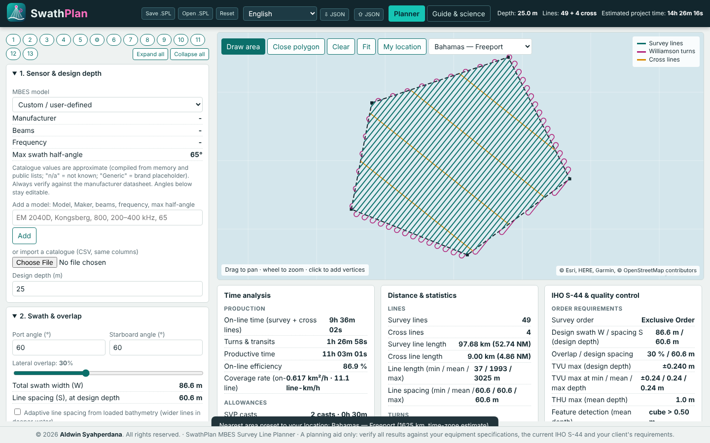
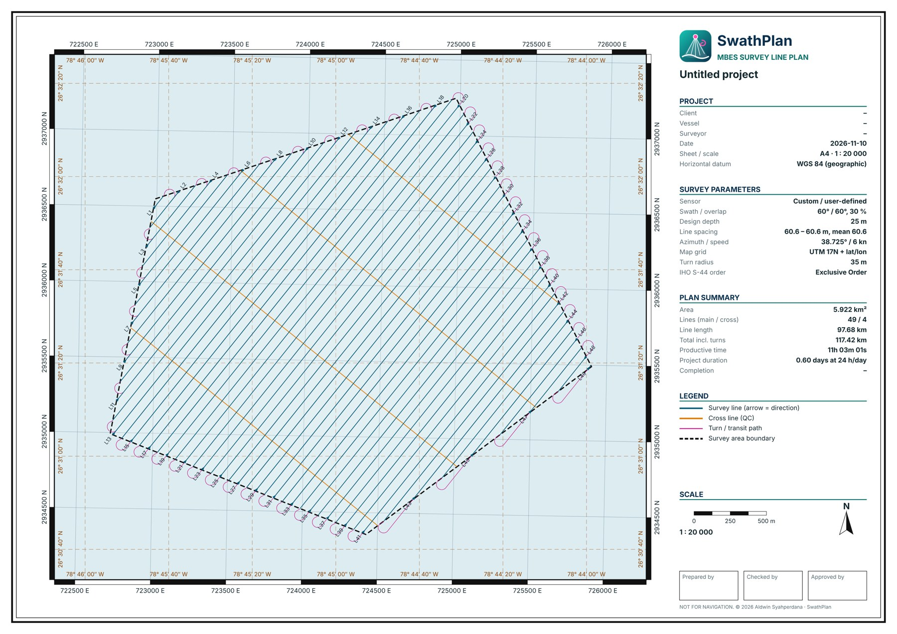

# SwathPlan

**A free multibeam (MBES) survey line planner that runs in your browser.**
Draw the area, set your sonar, get the lines, check them against IHO S-44, and export them for your acquisition software. It is one HTML file with nothing to install and no account to create.

▶ **Live app:** https://syahperdana.github.io/swathplan/
🎬 **Demo video (84 s):** [docs/demo.mp4](docs/demo.mp4)

---

## Why I built it

Planning MBES lines usually means a spreadsheet for line spacing, a CAD file for the geometry and a calculator for the time estimate. I wanted to do all of that on one page, quickly, and hand clients a sheet that looks like a proper plan.

SwathPlan is a **planning aid**. It does not replace your acquisition software or your own judgement (see [Disclaimer](#disclaimer)).

## What it does

**Planning**
- Draw the survey area on the map, or import a boundary from a file or pasted coordinates (including plain `x y` or `lon, lat` lists, which it detects automatically).
- Line spacing from swath angles, overlap and design depth, or adaptive spacing from loaded bathymetry.
- Line azimuth to **3 decimals**, plus an **Auto optimal** button that searches for the fewest lines.
- **Cross lines**: choose how many, spaced evenly across the area, with their own name prefix.
- Williamson and U-turn paths, time and distance estimates, and a cost and operations summary.
- Coastline and land avoidance, and trimming of lines to navigable water.

**Quality checks**
- IHO S-44 order requirements: spacing, overlap, TVU/THU, feature detection and a cross-line consistency check.
- Sensor catalogue with editable models.

**Data**
- Global bathymetry from public sources (GMRT, NOAA NCEI, EMODnet, GEBCO), your own GeoTIFF or ESRI ASCII grid, or your own XYZ file.
- Area presets for many ports and survey regions.
- Projected coordinate systems: UTM, and EPSG or custom definitions.

**Output**
- Line exports: HYPACK (LNX, LNW), EIVA RLN, Qinsy `.qgfline`, DXF, Shapefile, KML, GPX, GeoJSON, CSV/TXT/WKT/GML/MIF, NMEA, QGroundControl, Mission Planner.
- A print-ready **map sheet** (A4 or A3, PNG or PDF) with scale bar, north arrow, legend and title block. The grid can show **projected E/N**, **lat/lon**, or **both**.
- A PDF report with the plan, the maths and the line list.
- Save and reopen your project as a plain-text `.SPL` file. Changes are also autosaved in your browser.

**Everything else**
- 22 languages, picked automatically from your location, and switchable at any time.
- Works on a laptop or a phone.

## How to use it

### Option A: open it online
Open the live link above. That is all.

### Option B: use it offline
1. Download `index.html` from this repository (open the file, then *Raw → Save as*).
2. Double-click it. It opens in your browser.

Some features need internet when you use them: map background tiles, global bathymetry downloads, and loading EPSG definitions. Planning, S-44 checks and exports work offline.

### A first plan in 5 steps
1. **Set your sensor** (section 1): pick a model or type the swath half-angle, then set the design depth.
2. **Swath and overlap** (section 2): the line spacing updates immediately.
3. **Draw the area**: press *Draw area*, click the corners on the map, then *Close polygon*. You can also import a boundary in section 9.
4. **Set the direction** (section 3): drag the slider, type an azimuth, or press *Auto optimal*. Add cross lines here too.
5. **Export** (section 13): choose the coordinate system, then export the lines or the map sheet.

### Tips
- The number buttons at the top of the left panel jump to a section. Press one again to close it.
- Pick the coordinate system in section 13 **before** exporting. EIVA RLN and the sheet grid follow it.
- If you load a boundary as plain text, the tool tells you whether it read it as degrees or as the coordinate system from section 8.

## Export notes

| Format | Notes |
|---|---|
| **EIVA RLN** | Follows the Helmsman runline format: a quoted line name, then `E,N,KP` rows. Written in the coordinate system you choose. |
| **Qinsy `.qgfline`** | Rebuilt from a single sample file. It writes straight lines in WGS 84 UTM only (zone from the area centre). **Please test-import a small file before field use.** |
| **HYPACK LNX / LNW** | Written from knowledge of the format. **Please test-import before field use.** |
| **DWG** | Cannot be written from a browser. Open the DXF in AutoCAD or BricsCAD and save as DWG. |

## Browser support

Tested in Chromium (Chrome, Edge) and Firefox. It is also designed for Safari, but report anything odd you see.

## Feedback

I'd really like to hear from people who plan surveys: what is missing, what is confusing, which export you need. Please open an **Issue** with the browser, a short description and, if you can, a screenshot or your `.SPL` file.

## Disclaimer

SwathPlan is a planning aid. Catalogue values for sonars are approximate and compiled from public information, so always check them against the manufacturer's datasheet. Verify all results against your equipment specifications, the current IHO S-44 and your client's requirements. The software is provided as is, without warranty.

## Licence

Free to use, including for commercial survey work. Please do not resell it or redistribute modified copies as your own. See [LICENSE](LICENSE).

---

© 2026 Aldwin Syahperdana
